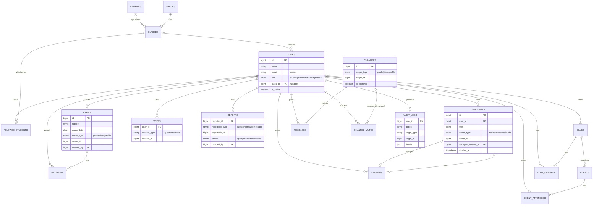

# 164 ГПИЕ — ученическа платформа

Общностен сайт за учениците от **164. ГПИЕ „Мигел де Сервантес“** (София, 8.–12. клас).
Features: whitelist-restricted registration/login, exams & study materials, Q&A, clubs & events, student-only channels, admin panel & moderation (see [Features](#features)).

## Stack

| Layer | Tech |
| --- | --- |
| Backend | Laravel 13 (PHP 8.4), Laravel Breeze (Vue + Inertia stack) |
| Frontend | Vue 3, Inertia.js 2, Tailwind CSS 3, Vite |
| Database | PostgreSQL (18 in Sail, 14+ works natively) |
| Local dev | Laravel Sail (Docker) — primary; native WSL2 — alternative |
| Tests | Pest (feature tests against PostgreSQL), Laravel Pint |
| CI | GitHub Actions (`.github/workflows/ci.yml`) |

UI language is Bulgarian (`APP_LOCALE=bg`), timezone `Europe/Sofia`.

---

## Windows + WSL2 setup

1. Install WSL2 with Ubuntu (PowerShell as admin):
   ```powershell
   wsl --install -d Ubuntu
   ```
2. For the **Sail** path install [Docker Desktop](https://www.docker.com/products/docker-desktop/) and enable
   *Settings → Resources → WSL integration → Ubuntu*.
3. Open the Ubuntu terminal and work **inside the Linux filesystem** (see gotchas below):
   ```bash
   mkdir -p ~/code && cd ~/code
   git clone https://github.com/EmilBuchukov/student-helper-164.git
   cd student-helper-164
   ```

### WSL gotchas

- **Clone into `~/…`, not `/mnt/c/…`.** Projects on the Windows drive are 10–50× slower (file I/O and Vite file watching) and can have permission/line-ending issues.
- Open the project from WSL with `code .` (VS Code + "WSL" extension).
- If `docker` is "command not found" inside Ubuntu, Docker Desktop's WSL integration is not enabled for that distro — enable it and restart the terminal.
- `permission denied while trying to connect to the docker API at unix:///var/run/docker.sock` → your WSL user isn't in the `docker` group: `sudo usermod -aG docker $USER`, then `wsl --shutdown` (PowerShell) and reopen Ubuntu; `docker ps` should work without sudo. With Docker Desktop also make sure it is running and WSL integration is on for your distro.
- `http://localhost` shows the **Apache default page** → Apache is running in WSL and holds port 80 (often pulled in by `apt install php…` without `-cli`). Run `sudo service apache2 stop && sudo systemctl disable apache2` (or `sudo apt remove apache2`), then `sail down && sail up -d`. Alternatively set `APP_PORT=8080` in `.env` and open http://localhost:8080. Native path uses http://localhost:8000.
- Port 5432 already in use? A native PostgreSQL is running in WSL (`sudo service postgresql stop`) or set `FORWARD_DB_PORT=5433` in `.env`.
- Hot reload not picking up changes → you're probably on `/mnt/c`.

---

## Option A — Laravel Sail (Docker, recommended)

Prerequisites: Docker Desktop (with WSL integration) — nothing else; PHP/Composer/Node run inside the container.

```bash
# 1. Install PHP dependencies (one-off container, no local PHP needed)
docker run --rm -u "$(id -u):$(id -g)" -v "$(pwd):/var/www/html" -w /var/www/html \
    laravelsail/php84-composer:latest composer install --ignore-platform-reqs

# 2. Environment
cp .env.example .env
#    edit .env: set DB_PASSWORD (any value, e.g. "password") and SEED_ADMIN_PASSWORD

# 3. Start containers (app, pgsql, mailpit)
./vendor/bin/sail up -d

# 4. App key, database, frontend
./vendor/bin/sail artisan key:generate
./vendor/bin/sail artisan migrate --seed
./vendor/bin/sail npm install
./vendor/bin/sail npm run dev
```

Open **http://localhost**. Mailpit (password-reset / verification emails): **http://localhost:8025**.

Tip: `alias sail='sh $([ -f sail ] && echo sail || echo vendor/bin/sail)'` in `~/.bashrc`.

Stop: `sail down` (add `-v` to also delete the database volume).

---

## Option B — Native WSL2 (no Docker)

Prerequisites: PHP 8.4 (+ `pgsql`, `mbstring`, `xml`, `curl`, `zip`, `intl`, `bcmath`), Composer 2, Node 22, PostgreSQL 14+.

```bash
# PHP 8.4 + extensions
sudo add-apt-repository -y ppa:ondrej/php && sudo apt update
sudo apt install -y php8.4-cli php8.4-pgsql php8.4-mbstring php8.4-xml php8.4-curl \
    php8.4-zip php8.4-intl php8.4-bcmath unzip

# Composer
curl -sS https://getcomposer.org/installer | php && sudo mv composer.phar /usr/local/bin/composer

# Node 22 (via nvm)
curl -o- https://raw.githubusercontent.com/nvm-sh/nvm/v0.40.1/install.sh | bash && source ~/.bashrc
nvm install 22

# PostgreSQL
sudo apt install -y postgresql
sudo service postgresql start
sudo -u postgres psql -c "CREATE ROLE sail LOGIN PASSWORD 'password';"
sudo -u postgres psql -c "CREATE DATABASE school164 OWNER sail;"
sudo -u postgres psql -c "CREATE DATABASE testing OWNER sail;"
```

Then in the project:

```bash
composer install
npm install
cp .env.example .env
```

Edit `.env`:

```dotenv
DB_HOST=127.0.0.1
DB_PASSWORD=password
MAIL_MAILER=log            # emails (reset links) go to storage/logs/laravel.log
SEED_ADMIN_PASSWORD=...    # choose one
```

```bash
php artisan key:generate
php artisan migrate --seed
composer run dev            # php artisan serve + queue + vite together
```

Open **http://localhost:8000**.

---

## Demo accounts (after `migrate --seed`)

| Role | Email | Password |
| --- | --- | --- |
| Admin | `SEED_ADMIN_EMAIL` from `.env` (default `admin@example.com`) | `SEED_ADMIN_PASSWORD` from `.env` |
| Teacher | `teacher@example.com` | `password` |
| Moderator | `moderator@example.com` | `password` |
| Student | `student@example.com` | `password` |

Demo passwords are for local development only. If `SEED_ADMIN_EMAIL`/`SEED_ADMIN_PASSWORD` are empty the seeder skips the admin account.

### Trying whitelist registration

Registration only works for an email that is in `allowed_students` and not yet claimed.
The seeder creates one unclaimed row, `newstudent@example.com`.

1. Go to `/register` and register with `newstudent@example.com` → you get role `student` and the class from the whitelist row; the row is marked claimed.
2. Try `someone@example.com` (not on the list) or `newstudent@example.com` again → *„Този имейл не е в списъка на училището. Свържи се с администратор.“*
3. As admin, open **Админ → Импорт на ученици** (`/admin/students/import`) and upload [`docs/sample-students.csv`](docs/sample-students.csv) to see the created / skipped / invalid report. CSV format: header `email,grade,letter` (comma or semicolon, UTF-8, letter in Cyrillic, class must exist).

New accounts must verify their email before reaching the dashboard (link in Mailpit or in `storage/logs/laravel.log`).

---

## Features

### Audience scoping (shared)

Exams, questions and channels target an audience via two columns: `scope_type` (`grade` | `class` | `profile`) and `scope_id`.
`App\Models\Concerns\HasAudienceScope` provides:

- `Model::query()->visibleTo($user)` — only items for the user's class, grade or profile;
- `$model->isVisibleTo($user)`, `$model->audienceLabel()` and a `scope()` morphTo relation (eager-load it on lists);
- per-model hooks: `audienceSeesAll()` (default: admins + moderators), `audienceHiddenFrom()`, `audienceIncludesUnscoped()`.

`App\Support\Audience` has `scopesFor($user)`, `userBelongsTo($user, $type, $id)` and `options()` for select boxes
(values are encoded as `"class:5"` and validated with `App\Rules\AudienceScopeRule`). The scope types double as morph aliases
(`Relation::enforceMorphMap` in `AppServiceProvider`).

### Exams & materials (`/exams`)

- List with upcoming exams first (soonest first), then past exams; filters by subject, date range and audience.
- Students/moderators create exams for their own class, grade or profile; admins and teachers for any audience.
  Creator, moderators and admins can edit/delete.
- Teachers see all exams and can download materials, but cannot upload (materials are a student space).
- Materials: pdf, docx, pptx, xlsx, txt, png, jpg (max 10 MB). The server checks the detected MIME type, the extension,
  and that both match. Files are stored under a random name in `materials/{exam_id}/` and only downloaded through
  `GET /materials/{id}/download`, which checks authorization and sends the original filename. Uploads are rate limited (10/min).

### Q&A (`/questions`) — students only

- Questions are school-wide (no scope) or targeted at the author's class/grade/profile (admins: any). Same `visibleTo()` scoping as exams.
- **Teachers are denied completely**: the `no-teachers` route middleware (`DenyTeachers`) returns 403 on every Q&A/report route,
  and `QuestionPolicy`/`AnswerPolicy` + `Question::audienceHiddenFrom()` also deny them (defence in depth).
- Answers, toggleable upvotes (`votes`, one per user/item, not on own content), one accepted answer per question (author toggles it).
- List: search, subject/audience filters, sort by newest / most voted / unresolved.
- **Search uses `ILIKE`** on title + body (escaped `%`/`_`). Chosen over PostgreSQL full-text search because PostgreSQL ships no
  Bulgarian stemmer, users search for partial words, and the data volume of one school is small. If it grows, add a `pg_trgm` GIN index.
- Users edit/delete their own questions/answers; moderators and admins can delete anything (soft deletes, restorable later).
- **Reports** (`reports` table, shared with channel messages): reason required, at most one *open* report per user and item
  (validated + partial unique index `reports_one_open_per_user`).
- Rate limits per user: questions 5/min, answers 10/min, votes 60/min, reports 10/min.

### Clubs & events (`/clubs`, `/events`)

- Clubs (`slug` URLs, generated from the Bulgarian name) with an optional leader (a student/moderator) and `is_active`.
  Inactive clubs are visible only to admins and their leader.
- **Admins** create/edit/delete clubs and any event, including **school-wide events** (`club_id = null`).
  A **club leader** creates/edits/deletes events of their own club only (`ClubPolicy::manageEvents`, `EventPolicy::createFor`).
- Students (and moderators/admins) join/leave clubs and RSVP to events as `going` / `interested` (one RSVP per user, changeable).
- **Teachers** can browse clubs and events but cannot join or RSVP (403).
- Events list: upcoming (not yet finished) by default, past on request, filter by club or school-wide.

### Channels (`/channels`) — students only

- One channel per grade, class and profile, created by `ChannelService` (`syncAll()` in `ChannelSeeder`) and kept in sync by
  `SchoolStructureObserver` (new/renamed class, grade or profile → channel created/renamed; deleted → channel archived).
  Run `php artisan db:seed --class=ChannelSeeder` to (re)create channels for existing data.
- **Teachers have no access at all**: `no-teachers` middleware (403 on every channel/message/mute route), `ChannelPolicy`
  and `Channel::audienceHiddenFrom()` (so `Channel::visibleTo($teacher)` is always empty). The nav link is hidden for them.
- Students see only the channels of their class, grade and profile; moderators and admins see all channels (moderation).
- Messages: max 2000 characters, 20/min per user, "load more" pagination (`?before=<id>`), soft deletes.
  Authors delete their own messages; moderators/admins delete any and **mute** users in a channel or globally
  (`channel_mutes`, 15 min – 1 week). Muted users see a notice and get 403 when posting. Anyone can report a message (shared `reports`).
- **Real-time:** the page polls `GET /channels/{id}/messages?after=<last id>&since=<server_time>` every
  `CHANNEL_POLL_SECONDS` (default 7) while the tab is visible; the response also carries deleted message ids and the
  current mute. No WebSockets yet. To add **Laravel Reverb** later: broadcast a `MessagePosted`/`MessageDeleted` event
  from `MessageController` on a private channel `channels.{id}` authorized with `ChannelPolicy::view`, listen with Laravel Echo in
  `Pages/Channels/Show.vue` (reusing `append()`), and keep polling as a fallback.

### Admin panel & moderation (`/admin`, `/moderation`)

- **Dashboard** (`/admin`): counts (users, students, suspended, exams, questions, open reports, active mutes, pending whitelist), quick links, latest audit entries.
- **Reports queue** (`/moderation/reports`, moderators + admins): open reports first, with content preview, author, reporter, reason and a link.
  *Dismiss*, or *Resolve* with optional content removal (soft delete), global author mute (15 min – 1 week) and — admins only — author suspension.
  `handled_by`/`handled_at`/`resolution_note` are recorded; removing content also resolves every other open report about it.
- **Users** (`/admin/users`): search by name/email, filter by role/status, detail page with content counts, reports against their content and mute history;
  role change (admins, never their own) and **suspend/reactivate** (`is_active`). Suspended users cannot log in (`LoginRequest`), are logged out
  on their next request (`EnsureUserIsActive`), and their database sessions + remember token are invalidated (`UserSuspension`).
- **Whitelist** (`/admin/whitelist`): `allowed_students` with claimed/pending status, add/remove single entries (claimed ones cannot be removed), link to the CSV import.
- **Изтрито съдържание** (`/admin/deleted`): soft-deleted questions, answers and messages; admins restore them.
- **Audit log** (`/admin/audit`, `audit_logs`): who, action, target (+ label snapshot), details, IP, time. Logged actions: moderator deletions
  (Q&A, messages, exams, materials — not deleting your own content), content restore, report dismiss/resolve, mute/unmute, suspend/reactivate,
  role change, whitelist add/remove.

### Permission matrix

| Feature | Student | Moderator | Teacher | Admin |
| --- | --- | --- | --- | --- |
| Exams: view | own class/grade/profile | all | all | all |
| Exams: create | own scopes | own scopes | any scope | any scope |
| Exams: edit/delete | own | any | own | any |
| Materials: upload / download | ✓ / visible exams | ✓ / all | ✗ / all | ✓ / all |
| Materials: delete | own | any | ✗ | any |
| Q&A: view, ask, answer, vote, report | own scopes + school-wide | all scopes | **403 everywhere** | all scopes |
| Q&A: edit | own | own | ✗ | own |
| Q&A: delete | own | any | ✗ | any |
| Clubs & events: view | ✓ | ✓ | ✓ (read-only) | ✓ |
| Clubs: join/leave, events: RSVP | ✓ | ✓ | ✗ | ✓ |
| Clubs: create/edit/delete | ✗ | ✗ | ✗ | ✓ |
| Events: manage | own club if leader | own club if leader | ✗ | all + school-wide |
| Channels: read/post/report | own class/grade/profile | all | **403 everywhere** | all (+ archived) |
| Channels: delete messages | own | any | ✗ | any |
| Channels: mute users | ✗ | ✓ (not admins/moderators) | ✗ | ✓ (not admins) |
| Reports queue | ✗ | ✓ | ✗ | ✓ (+ suspend author) |
| Admin panel (dashboard, users, roles, suspend, whitelist, import, restore, audit) | ✗ | ✗ | ✗ | ✓ |

Enforced by policies (`app/Policies`) plus route middleware (`role:admin`, `role:admin,moderator`, `no-teachers`);
tests iterate the sensitive routes as unauthorized roles.

### File storage (local / S3-compatible)

All uploads go through Laravel's `Storage` facade on the disk from `FILESYSTEM_DISK` (or `MATERIALS_DISK` to override it for materials).

- **Local (default):** `FILESYSTEM_DISK=local` → `storage/app/private` (not web-accessible; the local disk's `serve` option is off).
- **S3-compatible (production, ephemeral filesystem):** the `league/flysystem-aws-s3-v3` driver is installed; set

  ```dotenv
  FILESYSTEM_DISK=s3
  AWS_ACCESS_KEY_ID=...
  AWS_SECRET_ACCESS_KEY=...
  AWS_DEFAULT_REGION=auto            # or e.g. eu-central-1
  AWS_BUCKET=school164-materials
  AWS_ENDPOINT=https://<account>.r2.cloudflarestorage.com   # empty for AWS S3
  AWS_USE_PATH_STYLE_ENDPOINT=false  # true for MinIO
  ```

  Keep the bucket **private**; downloads are streamed through the app after the authorization check.
  Switching disks does not migrate existing files.

## Tests & checks

Tests run against the PostgreSQL `testing` database (created automatically by Sail; create it manually natively, see above).

```bash
# Sail
sail artisan test
sail npm run build
sail bin pint --test

# Native
php artisan test
npm run build
vendor/bin/pint --test
```

CI runs Pint, the test suite (PostgreSQL service) and `npm run build` on every push and pull request.

---

## Project structure

```
app/
  Enums/Role.php                         student | moderator | admin | teacher (+ Bulgarian labels)
  Http/Controllers/Admin/                Dashboard, User (search/role/suspend), Whitelist, StudentImport, DeletedContent, AuditLog
  Http/Controllers/Moderation/           ReportController (queue, dismiss, resolve)
  Http/Controllers/{Exams,Questions,Clubs,Channels}/  feature controllers
  Http/Middleware/DenyTeachers.php       `no-teachers`: 403 for teachers on Q&A, channels and reports
  Http/Controllers/Auth/                 Breeze auth; RegisteredUserController enforces the whitelist
  Http/Middleware/EnsureUserHasRole.php  `role:admin`, `role:admin,moderator`
  Http/Middleware/EnsureUserIsActive.php logs out deactivated users
  Http/Requests/                         Form Requests (RegisterRequest, LoginRequest, ImportStudentsRequest…)
  Models/                                User, Grade, Profile, SchoolClass (table `classes`), AllowedStudent, Exam, Material,
                                         Question, Answer, Vote, Report, Club, Event, Channel, Message, ChannelMute, AuditLog
  Models/Concerns/                       HasAudienceScope (`visibleTo()`), Votable, Reportable
  Observers/SchoolStructureObserver.php  auto-creates/archives channels
  Policies/                              Exam, Material, Question, Answer, Club, Event, Channel, Message
  Services/                              StudentImportService, MaterialStorage, ChannelService, UserSuspension
  Support/Audience.php                   audience helpers (scopes of a user, options, decode)
config/school.php                        seed admin, material upload limits/disk, channel poll interval
database/migrations|factories|seeders/
docs/sample-students.csv
lang/bg/                                 auth, validation, passwords, pagination, ui (frontend strings)
resources/js/
  Layouts/AppLayout.vue                  responsive navbar + mobile menu + footer
  Pages/                                 Welcome, Dashboard, Auth/*, Profile/*, Exams/*, Questions/*, Clubs/*,
                                         Events/*, Channels/Show, Admin/*, Moderation/Reports/Index
  http.js                                fetch wrapper (XSRF) for channel polling
  i18n.js                                `$t('key')` helper fed from lang/bg/ui.php via Inertia
routes/web.php, routes/auth.php
tests/Feature/                           auth, registration, admin, exams, Q&A, clubs, channels, moderation, translation keys
```

Frontend strings live in `lang/bg/ui.php`; they are shared to Vue as flattened keys (`nav.home`) and used with `$t('nav.home')`.

---

## Database schema

| Table | Columns | Notes |
| --- | --- | --- |
| `grades` | `id`, `number` | unique, CHECK 8–12 |
| `profiles` | `id`, `name` | Химия, Биология, Математика, Предприемачество, Физика, География, История |
| `classes` | `id`, `grade_id` → grades, `letter`, `profile_id` → profiles (nullable) | unique (`grade_id`, `letter`); grade delete restricted, profile delete nulls |
| `users` | Breeze columns + `role` (enum), `class_id` → classes (nullable), `is_active` | class delete nulls `class_id` |
| `allowed_students` | `id`, `email` (unique), `class_id` → classes, `claimed_at`, `claimed_by` → users | class delete restricted; user delete nulls `claimed_by` |
| `exams` | `subject`, `title`, `description`, `exam_date`, `type`, `scope_type`+`scope_id`, `created_by` → users | indexed on scope, date, subject |
| `materials` | `exam_id` → exams, `user_id` → users, `title`, `path` (random, private), `original_name`, `mime_type`, `size` | |
| `questions` | `user_id`, `title`, `body`, `subject`, `scope_type`+`scope_id` (null = school-wide), `accepted_answer_id` → answers | soft deletes |
| `answers` | `question_id` → questions, `user_id`, `body` | soft deletes |
| `votes` | `user_id`, `votable_type`+`votable_id` | unique per user/item |
| `reports` | `reporter_id`, `reportable_type`+`reportable_id`, `reason`, `status` (open/resolved/dismissed), `handled_by`, `handled_at`, `resolution_note` | partial unique index: one open report per user/item |
| `clubs` | `name`, `slug` (unique), `description`, `leader_id` → users, `is_active` | |
| `events` | `club_id` → clubs (null = school-wide), `title`, `description`, `starts_at`, `ends_at`, `location`, `created_by` | |
| `club_members` | `club_id`, `user_id`, `joined_at` | unique pair |
| `event_attendees` | `event_id`, `user_id`, `status` (going/interested) | unique pair |
| `channels` | `name`, `scope_type`+`scope_id` (unique), `is_archived` | one per grade/class/profile |
| `messages` | `channel_id`, `user_id`, `body` (≤ 2000) | soft deletes; index (`channel_id`, `id`) |
| `channel_mutes` | `channel_id` (null = global), `user_id`, `muted_until`, `reason`, `created_by` | |
| `audit_logs` | `user_id` (actor), `action`, `target_type`+`target_id`, `details` (json), `ip_address`, `created_at` | |

Polymorphic columns use the aliases from `Relation::enforceMorphMap()` in `AppServiceProvider` (`question`, `answer`, `message`, `user`, …).



## Out of scope

- Room occupancy / bookings.
- Real-time WebSockets: channels poll every few seconds; see the Reverb notes in [Channels](#channels-channels--students-only).
